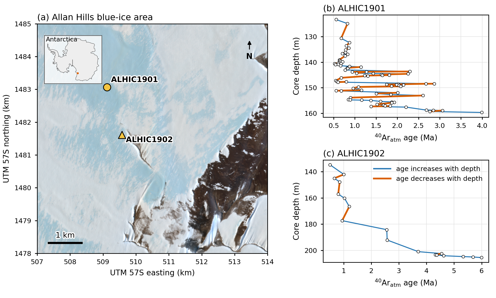
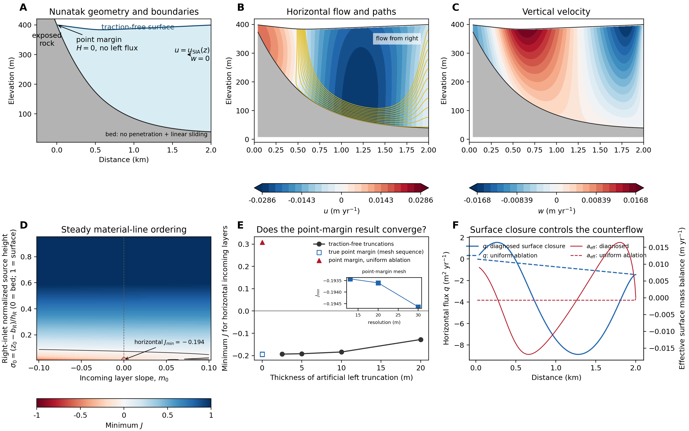
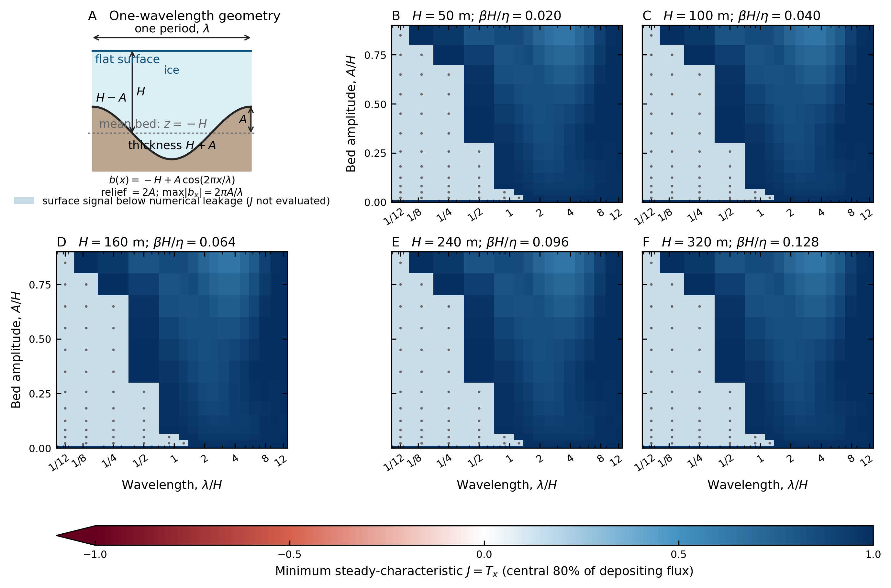

# Isochrone overturning in steady glacier flow

Theoretical analysis, finite-element Stokes modeling, large-scale parameter-space sweeps, and manuscript source for ***Isochrone overturning in steady glacier flow*** (EarthArXiv preprint, September 2026; revised *Journal of Glaciology* submission `JOG-2026-0127`, November 2026).

Ice cores from the Allan Hills blue-ice area in East Antarctica recover ice and trapped air reaching into the Miocene (23–5.3 Ma), yet metre-scale age reversals, steep dips, and basal folds obscure the stratigraphic record ([Shackleton et al., 2025](https://doi.org/10.1073/pnas.2502681122); [Marks-Peterson et al., 2026](https://doi.org/10.1038/s41586-025-10032-y)). Whether steady glacier flow over fixed topography can turn surface-deposited layers upside down—or whether observed inversions require transient forcing, multiple sources, or rheological heterogeneity—has remained an open mechanical question.

This project converts that observational ambiguity into a well-posed analytical criterion, a direct characteristic-based numerical diagnostic, and an audited multi-thousand-run evaluation suite.

| Artifact | Location | Status |
| --- | --- | --- |
| Revised manuscript (*Journal of Glaciology*, `JOG-2026-0127`) | [`latex/manuscript.pdf`](latex/manuscript.pdf) / [`latex/manuscript.tex`](latex/manuscript.tex) | 39 pp., clean build |
| EarthArXiv preprint (3 September 2026) | [`latex/eartharxiv-preprint.pdf`](latex/eartharxiv-preprint.pdf) | Submitted |
| Point-by-point response to reviewers (40 items) | [`latex/response_to_reviewers.pdf`](latex/response_to_reviewers.pdf) | Complete |
| Tracked-changes diff vs. original submission (`main_v0`) | [`latex/main_diff.pdf`](latex/main_diff.pdf) | Clean build |
| Revision verification checklist | [`revision-checklist.md`](revision-checklist.md) | 40/40 reviewer items resolved |
| Reproducible Firedrake/Icepack container | [`Dockerfile`](Dockerfile) | `firedrake-vanilla:2025-01` |


*Figure 1 of the manuscript: Copernicus Sentinel-2 L2A setting of the Allan Hills blue-ice area and published $`^{40}\mathrm{Ar}_{\mathrm{atm}}`$ age–depth inversions in cores ALHIC1901 and ALHIC1902 ([Shackleton et al., 2025](https://doi.org/10.1073/pnas.2502681122); [Marks-Peterson et al., 2026](https://doi.org/10.1038/s41586-025-10032-y)).*

---

## Core formulation and analytical results

Curvature alone does not diagnose overturning: strongly arched or draped isochrones can remain single-valued in depth. Instead, stratigraphic order—the horizontal sequence of neighboring parcels deposited along the surface at $`x_0`$ and $`x_0 + \delta x_0`$—is quantified directly by the signed **isochrone-order Jacobian**:

$$
\mathcal{J}(x, x_0) = \left.\frac{\partial x}{\partial x_0}\right|_{\tau} = -\dot{a}_0 \tau_z.
$$

Ordered stratigraphy corresponds to $`\mathcal{J} > 0`$, a vertical tangent to $`\mathcal{J} = 0`$, and an overturned limb to $`\mathcal{J} < 0`$. While layers remain ordered, $`\mathcal{J} = \lambda_z^{-1}`$ is the reciprocal of the vertical thinning function; unlike $`\lambda_z`$, $`\mathcal{J}`$ passes smoothly through zero at a vertical tangent while area conservation ($`\det \mathbf{F} = 1`$) keeps the layer tangent non-singular.

Casting steady incompressible age transport ($`u\tau_x + w\tau_z = 1`$) in canonical streamfunction–age coordinates $`(\tau, \psi)`$ yields an exact trajectory-integrated order budget (Theorem 1):

$$
\mathcal{J} = \frac{u(x,z)}{u_{s0}}\bigl(1 + \mathcal{P} - \mathcal{R}\bigr),
\qquad
\mathcal{P} = \dot{a}_0 u_{s0}\int_{x_0}^{x}\frac{u_z^+}{u^3}\,d\xi,
\qquad
\mathcal{R} = \dot{a}_0 u_{s0}\int_{x_0}^{x}\frac{u_z^-}{u^3}\,d\xi.
$$

Deposition supplies a unit baseline, ordinary positive vertical shear ($`u_z > 0`$) reinforces order through $`\mathcal{P}`$, and reverse shear ($`u_z < 0`$) erodes it through $`\mathcal{R}`$—weighted by $`u^{-3}`$, so slow near-stagnant ice amplifies reverse shear disproportionately. Local extrusion ($`u_z < 0`$) is therefore necessary but not sufficient: overturning begins only once $`\mathcal{R} = 1 + \mathcal{P}`$.

Decomposing vertical shear directly from the Stokes momentum balance, $`u_z = G + R_{\mathrm{S}}`$ (gravitational driving shear $`G`$ plus non-shallow Stokes residual $`R_{\mathrm{S}}`$ from $`-w_x`$, longitudinal stress gradients $`\tau_{xx,x}`$, nonhydrostatic pressure gradients $`-p_{\mathrm{nh},x}`$, and surface shear stress), establishes four order-preservation regimes:

- **Strictly downhill, one-way shallow-ice flow ($`s_x < 0`$, $`u > 0`$):** $`u_z \ge 0`$ pointwise, so $`\mathcal{R} = 0`$ and $`\mathcal{J} > 0`$ identically.
- **Regular thin-film Stokes flow ($`\varepsilon = H/L \ll 1`$):** $`R_{\mathrm{S}} = O(\varepsilon^2 U/H)`$, giving integrated perturbation $`\mathcal{F} = O\bigl((\dot{a}/U)\varepsilon\bigr)`$, which cannot overcome the unit baseline whenever $`(\dot{a}/U)\varepsilon \ll 1`$.
- **Localized obstacle bound (Proposition 1):** Reverse shear bounded by $`\dot{\gamma}_{\mathrm{rev}}`$ over horizontal length $`\ell`$ with $`u \ge U_{\min}`$ satisfies $`\mathcal{R} \le \dot{a}_0 U_{\mathrm{dep}} \dot{\gamma}_{\mathrm{rev}} \ell / U_{\min}^3`$; a solitary bump in non-stagnant throughflow yields $`\mathcal{R} = O(\dot{a}/U)`$.
- **First-order periodic cancellation:** Small-amplitude periodic bed perturbations about uniform plug flow cancel to $`O(\epsilon_b^2)`$ across each full wavelength.

---

## Computational architecture and diagnostic design

A central engineering outcome of this project is replacing time-dependent Lagrangian cohort advection—which suffered from arbitrary reporting horizons and common-first-exit censoring—with a **direct steady variational-tangent characteristic solver**:

$$
\frac{d\mathbf{X}}{dt} = \mathbf{u}(\mathbf{X}),
\qquad
\frac{d\mathbf{F}}{dt} = \nabla\mathbf{u}(\mathbf{X})\,\mathbf{F},
\qquad
\mathcal{J}_{\mathrm{T}} = T_x = F_{11} + m_0 F_{12}.
$$

1. **Stokes finite-element solve:** Steady incompressible Stokes flow is discretized with Taylor–Hood elements in [Firedrake](https://www.firedrakeproject.org/), enforcing basal impermeability via symmetric Nitsche terms and passive linear basal sliding ($`u_t = C\tau_b`$, $`\tau_b = -\mathbf{t}\cdot\boldsymbol{\sigma}\cdot\mathbf{n}`$, $`C = 10^{-5}\ \mathrm{m\,yr^{-1}\,Pa^{-1}}`$, ensuring strictly dissipative basal work $`\tau_b u_t = C\tau_b^2 \ge 0`$).
2. **Direct variational characteristic integration:** Rather than finite-differencing adjacent particle trajectories or solving an Eulerian age PDE, each characteristic simultaneously integrates position and the deformation gradient (or equal-age material tangent $`\mathbf{T} = \mathbf{F}\mathbf{T}_0`$). Along one-way surface-sourced trajectories ($`m_0 = s_x(x_0)`$), $`\mathcal{J}_{\mathrm{T}}`$ equals $`\mathcal{J}`$ exactly; unlike the $`u^{-3}`$ integrals, it remains regular across $`u = 0`$ and horizontal counterflow, agrees with centered finite-difference maps to $`\le 7.73\times 10^{-5}`$, and follows every source independently to physical exit.
3. **Scalable sweep and verification harness:** Parameter-space sweeps run in parallel across CPU workers (`ProcessPoolExecutor`) with schema-versioned, restartable CSV/JSON outputs, discrete weak-form residual checks (e.g., $`\le 8.2\times 10^{-13}`$ in the sinusoidal sweep), explicit signal-to-noise screening (masking short-wave cells whose surface velocity signal falls below 10× RMS basal normal leakage rather than misclassifying roundoff), and dedicated single-factor validation suites varying mesh spacing, time step, sampler resolution, source count, and domain truncation.

### Agent-assisted engineering and verification discipline

As documented in the manuscript acknowledgements, this repository was built over a multi-month, long-horizon workflow using AI coding agents (**OpenAI Codex** and **Google Antigravity / Gemini**) under explicit human specification, mathematical review, and automated verification across 147 commits:

- **First-principles task constraints ([`AGENTS.md`](AGENTS.md)):** Agent sessions are constrained against contrived shortcuts—no synthetic interior layer clipping, no heuristic constraints, explicit units and boundary conditions, and strict separation between observations, calculations, and inferences.
- **Handcrafted analytical and numerical graders:** Rather than trusting aggregate fit metrics, every solver family is checked against closed-form analytical limits (machine-precision flat-bed sliding, exact $`J \to 1`$ recovery down to $`A = 0.001\ \mathrm{m}`$, lubrication-limit monotonicity, and analytical convergent-flow benchmarks), independent cross-method diagnostics (variational tangent vs. centered finite-difference vs. Eulerian audits), and single-factor mesh/step/sampler/inlet convergence tables.
- **Adversarial failure-mode auditing:** Several early implementations passed superficial targets while violating physical or numerical specifications—including a surface-forcing fit that reached 0.412 Ma RMS only by clipping the interior packet boundary, prescribed-speed folds powered by unphysical basal work (34–114× gravity), finite-horizon cohorts that censored 162–228 overturns, and short-wave roundoff below the basal-leakage floor. Catching and formalizing these failure modes drove the final diagnostic design and the 44-item SHA-256-audited build checklist in [`revision-checklist.md`](revision-checklist.md).

---

## Manuscript Stokes experiments

The revised manuscript pairs two contrasting steady Stokes experiments under the same linear viscosity ($`\eta = 2.5\times 10^8\ \mathrm{Pa\,yr}`$), density ($`\rho = 917\ \mathrm{kg\,m^{-3}}`$), and passive linear sliding law ($`C = 10^{-5}\ \mathrm{m\,yr^{-1}\,Pa^{-1}}`$).

### 1. Convergent point-margin flow (idealized nunatak analogue)

An idealized 2 km domain thickens smoothly from a true zero-thickness grounded point margin ($`H(0) = 0`$, zero left boundary facet or flux) to 360 m at the right inlet, where a reduced linear-viscous SIA inflow (1% of reference flux, $`w = 0`$) converges against rightward surface-slope-driven flow near the wedge tip beneath a traction-free surface.

- **Overturning without recirculation:** All trajectories are open, rising and exiting through the surface. Horizontal incoming lines reach a mesh-converged minimum $`J_{\min} = -0.1936`$ (varying from −0.1946 to −0.1934 across 30, 20, and 13 m meshes, and converging monotonically as positive-thickness left truncations shrink from 20 m to 2.5 m). Restricting sources to $`\sigma_0 \ge 0.05`$ still gives $`J_{\min} = -0.0574`$; moving the source plane 20 m inside the inlet gives $`J_{\min} = -0.1769`$.
- **Fold evolution:** A 30 m horizontal near-bed segment ($`\sigma_0 = 0.049`$) forms an S-shaped fold whose endpoint crosses $`J = 0`$ at 130.2 kyr and reaches $`J = -0.072`$ at 136.2 kyr.
- **Boundary-closure sensitivity:** Replacing the traction-free surface with prescribed uniform steady ablation on the exact same geometry eliminates overturning ($`J_{\min} = 0.3075`$), showing that surface/lateral mass-flux closure—not margin geometry alone—controls counterflow overturning.


*Figure 4 of the manuscript: geometry, velocity fields and open trajectories, inlet-parameter map of minimum $`J = T_x`$, and S-shaped fold evolution in the convergent point-margin flow ([report](notebooks/allan_hills_nunatak_margin_report.md), [convergence](figures/allan_hills_nunatak_margin_convergence.png)).*

### 2. Periodic sinusoidal-bed control (750 resolved runs)

A single periodic cell with flat upper surface, bed $`b(x) = -H + A\cos(2\pi x/\lambda)`$, and 0.05 rad mean slope tests whether smooth, finite-amplitude bed roughness generically overturns surface-deposited stratigraphy across five mean thicknesses ($`H \in \{50, 100, 160, 240, 320\}\ \mathrm{m}`$), 13 amplitudes ($`A/H = 0\text{–}0.85`$), and 16 wavelengths ($`\lambda/H = 1/12\text{–}12`$).

- **Universal order preservation across the resolved map:** All **750 resolved numerical cells** and **80 analytical flat-bed limits** remain ordered. The global minimum is $`J_{\min} = 0.6428`$ (raw-to-exit minimum 0.4428) at $`H = 50\ \mathrm{m}`$, $`A/H = 0.85`$, $`\lambda/H = 3`$, with peak distortion at intermediate coupling wavelengths ($`\lambda/H \approx 2\text{–}4`$) and recovery toward $`J = 1`$ in both short-wave screened and long-wave lubrication limits.
- **Explicit numerical-reach boundary:** 210 short-wave cells where the surface signal falls below 10× RMS basal normal leakage are explicitly left unclassified (dotted region) rather than interpreted.
- **No counterflow folding:** Small Eulerian reverse-flow pockets appear in 160 cells (peak speed ≈ 1.8% of maximum), yet no retained surface-deposition characteristic ever reverses horizontal direction.


*Figure 5 of the manuscript: minimum steady-characteristic order metric $`J = T_x`$ across 1,040 grid cells (750 resolved Stokes solves, 80 flat-bed limits, 210 leakage-screened cells) ([report](notebooks/steady_characteristic_sinusoidal_parameter_map.md), [validation](notebooks/steady_characteristic_sinusoidal_validation.md)).*

---

## Project evolution: falsification log and extended parameter campaign

The repository preserves the full scientific trajectory—over **4,000 resolved Stokes finite-element solves** and hundreds of convergence audits—including early hypotheses that were explicitly falsified and methodological confounds that forced tighter evaluation criteria.

### Phase 1 — Initial ALHIC1901 hypotheses and caught artifacts (July–August 2026)

| Experiment | Key finding | Diagnostic lesson | Artifacts |
| --- | --- | --- | --- |
| Surface mass-balance forcing (`n=3`, `n=1`) | Clipped workflow matched 3 ALHIC1901 folds (0.412 Ma RMS), but **unclipped** continuous column runs yielded **0 folds** (max displacement $`\le 3.88\times 10^{-4}\ \mathrm{m}`$ across 11 histories). | Apparent match was driven by an imposed interior packet top at 140.96 m; banned internal age/layer manipulation from all subsequent models. | [`unified_smb_alhic1901_fit_unclipped.ipynb`](notebooks/unified_smb_alhic1901_fit_unclipped.ipynb) |
| Transient bed uplift & static asymmetric obstacles | 15 m / 500 m transient bed displacement reached 10.5° dip; 51–68° static no-slip bumps/pits reached 33.8°–43.9° tilt over 25 kyr; **0 overturns**. | Large vertical relief and draping alone do not produce a recumbent fold. | [`transient_free_surface_bed_seed.ipynb`](notebooks/transient_free_surface_bed_seed.ipynb), [`asymmetric_bed_obstacles.ipynb`](notebooks/asymmetric_bed_obstacles.ipynb) |
| Prescribed basal speed vs. passive linear sliding | Earlier steady fold examples failed to overturn under passive $`u_t = C\tau_b`$ ($`J_{\min} \ge 0.576`$); energy audit showed prescribed-speed beds injected **34–114× gravitational power**. | Enforced strictly dissipative basal boundary conditions ($`C\tau_b^2 \ge 0`$) as a non-negotiable physical check. | [`linear_sliding_law_test.ipynb`](notebooks/linear_sliding_law_test.ipynb) |
| Circular-trough dissipative counterexample | Smooth circular trough with passive linear sliding overturned ($`J_{\min} = -0.224`$, 98.0% basal dissipation, open streamlines $`u \ge 0.100\ \mathrm{m\,yr^{-1}}`$). | Disproved a universal dissipativity no-folding conjecture and distinguished open-streamline overturning from closed Moffatt eddies; prompted broad geometry surveys. | [`dissipative_sliding_counterexample.ipynb`](notebooks/dissipative_sliding_counterexample.ipynb) |

### Phase 2 — Extended steady-characteristic geometry surveys (October–November 2026)

To separate single-example existence from geometric prevalence during *Journal of Glaciology* peer review, the direct variational-tangent solver was deployed across the additional geometry families summarized below:

| Geometry family | Resolved solves (grid) | Overturned? | Key result and physical insight | Report |
| --- | --- | --- | --- | --- |
| Periodic two-harmonic asymmetric beds | 1,281 (1,629 cells) | No | Adding an asymmetric second harmonic leaves every resolved case ordered down to $`A/H = 0.95`$ ($`J_{\min} = 0.4443`$ primary, 0.1739 raw). | [`steady_characteristic_two_harmonic_parameter_map.md`](notebooks/steady_characteristic_two_harmonic_parameter_map.md) |
| Finite elliptical troughs (hydrostatic open cuts) | 421 valid (702 cells) | Yes (277) | Direct-to-exit tracking exposed 162–228 overturns hidden by finite-age / first-exit censoring; separated counterflow (80 cases) from unidirectional overturning (197 cases). | [`steady_characteristic_elliptical_parameter_map.md`](notebooks/steady_characteristic_elliptical_parameter_map.md) |
| Asymmetric convergent basins (aspect & $`\kappa`$ sweeps) | 880 aspect; 715 valid $`\kappa`$ | Yes | Overturning occurs for $`L/H \le 30`$ (243/528 cells, $`J_{\min} = -12.16`$) and vanishes for $`L/H \ge 45`$; flattening the surface ($`\kappa = \Delta s/\Delta b < 1`$) systematically lowers $`J`$. | [`steady_tangent_convergent_aspect_parameter_map.md`](notebooks/steady_tangent_convergent_aspect_parameter_map.md), [`steady_tangent_convergent_kappa_parameter_map.md`](notebooks/steady_tangent_convergent_kappa_parameter_map.md) |
| Smooth periodic convergent continuation | 71 | Narrow band | Sub-percent flux band overturns next to a separatrix while opposing branches coexist; vanishes once mean slope restores one-way flow. | [`steady_characteristic_periodic_convergent.md`](notebooks/steady_characteristic_periodic_convergent.md) |
| Periodic icefall-to-tongue transitions | 75 (+4 analytic) | No | Severe thickness/slope transitions (bed slope up to 2.31) stay ordered ($`J_{\min} = 0.7102`$). | [`steady_characteristic_icefall_transition.md`](notebooks/steady_characteristic_icefall_transition.md) |
| Legacy periodic beds & finite bed spikes | 15 periodic; 6 spikes | No | Full-exit audit (up to 322 kyr) keeps all 15 trough/sill/riegel beds ordered ($`J_{\min} = 0.467`$); isolated finite spikes remain ordered ($`J_{\min} = 0.2583`$). | [`steady_characteristic_legacy_periodic.md`](notebooks/steady_characteristic_legacy_periodic.md), [`finite_spike_results.md`](notebooks/finite_spike_results.md) |
| Smooth localized two-scale bed packet | 40 pilot + refined audits | Extreme pinch only | Broad trough + narrow riegel overturns only near pinching ($`A/H = 0.90`$, slope 17.2; $`J_{\min} = -0.271`$, 0.92% flux). | [`steady_characteristic_localized_packet_report.md`](notebooks/steady_characteristic_localized_packet_report.md) |

---

## Diagnostic hierarchy and forward research agenda

Rather than claiming that steady flow explains Allan Hills stratigraphy, the analysis defines an actionable **evaluation hierarchy** for old-ice sites (Allan Hills, Little Dome C, and blue-ice margins):

1. **Steady-order screening:** Integrate $`\mathcal{P}`$, $`\mathcal{R}`$, and $`\mathcal{J}`$ along source-to-core trajectories in a reconstructed steady flow field; a positive budget excludes steady overturning.
2. **Full material-map escalation:** Where ice approaches stagnation (e.g., 0.4–0.5 mm yr⁻¹ basal speeds inferred upstream of the Allan Hills nunatak by Manos et al., 2026), recirculates, or draws from multiple accumulation zones / basal freeze-on, replace the scalar $`u^{-3}`$ budget with direct deformation-gradient tracking.
3. **3D and transient extension:** Extend $`\dot{\mathbf{F}} = (\nabla\mathbf{u})\mathbf{F}`$ to the two-dimensional surface-patch Jacobian in 3D flow around nunataks—testing steady 3D convergence against transient changes in geometry, ablation, or basal traction and anisotropic fabric buckling.
4. **Observational integration:** Combine trajectory-order predictions with direct imaging of steeply dipping englacial horizons targeted by COLDEX Phase II radar surveys and core-scale age/fabric constraints.

---

## Repository structure

```text
.
├── Dockerfile                   # Reproducible Firedrake (2025-01) + Icepack + notebook environment
├── AGENTS.md                    # Minimalist, first-principles modeling and verification conventions
├── revision-checklist.md        # 44-item audit table tracking JOG-2026-0127 peer-review revisions
├── latex/
│   ├── manuscript.tex / .pdf     # Revised Journal of Glaciology manuscript (39 pp.)
│   ├── main_v0.tex / .pdf        # Frozen original submission (1 September 2026)
│   ├── main_v1.tex / .pdf        # Mirror of revised submission
│   ├── main_diff.pdf             # latexdiff tracked changes vs. main_v0
│   ├── eartharxiv-preprint.pdf   # EarthArXiv preprint wrapper + PDF
│   ├── response_to_reviewers.pdf # Point-by-point responses to Reviewer 1 and Reviewer 2
│   └── references.bib            # BibTeX bibliography
├── notebooks/                   # 47 Python solvers/sweeps/plotters, 26 notebooks, 19 markdown reports
│   ├── allan_hills_nunatak_margin.py        # Manuscript Fig. 4 point-margin Stokes solver & diagnostic
│   ├── allan_hills_nunatak_validation.py    # Independent mesh/step/sampler/inlet audit
│   ├── steady_characteristic_sinusoidal_*   # Manuscript Fig. 5 1,040-cell sweep & validation
│   ├── steady_characteristic_*              # Extended two-harmonic, elliptical, icefall, packet sweeps
│   ├── steady_tangent_convergent_*          # Convergent-basin aspect-ratio and kappa sweeps
│   └── other-ideas/                         # Exploratory early mechanisms archived for transparency
├── data/                        # 59 schema-versioned CSV/CSV.GZ result and validation tables + Excel core data
└── figures/                     # Publication-grade PDF/PNG/EPS figures and Allan Hills context script
```

---

## Reproducing the calculations and manuscript

### Numerical experiments (Firedrake + Icepack)

Build and enter the containerized environment defined in [`Dockerfile`](Dockerfile):

```bash
docker build -t isochrone-overturning .
docker run --rm -it -v "$PWD":/workspace isochrone-overturning bash
source /home/firedrake/firedrake/bin/activate
```

Run the manuscript experiments or quick smoke checks from `/workspace`:

```bash
# Convergent point-margin experiment and convergence/truncation suite (Figure 4 & Figure S1)
python notebooks/allan_hills_nunatak_margin.py
python notebooks/allan_hills_nunatak_validation.py

# Periodic sinusoidal-bed quick smoke test, full parallel sweep (Figure 5), and validation audit
python notebooks/steady_characteristic_sinusoidal_parameter_map.py --smoke-grid
python notebooks/steady_characteristic_sinusoidal_parameter_sweep.py --jobs 4
python notebooks/steady_characteristic_sinusoidal_validation.py
```

### Manuscript PDF

```bash
cd latex
latexmk -pdf manuscript.tex
```

---

## Primary references

- [Shackleton et al. (2025), *Miocene and Pliocene ice and air from the Allan Hills blue ice area, East Antarctica*, PNAS](https://doi.org/10.1073/pnas.2502681122)
- [Marks-Peterson et al. (2026), *Broadly stable atmospheric CO2 and CH4 levels over the past 3 million years*, Nature](https://doi.org/10.1038/s41586-025-10032-y)
- Manos et al. (2026), *Ice flow controls on old ice preservation in the Allan Hills, Antarctica* (preprint)
- [Parrenin and Hindmarsh (2007), *Influence of a non-uniform velocity field on isochrone geometry along a steady flowline of an ice sheet*, Journal of Glaciology](https://doi.org/10.3189/002214307784409298)
- [Waddington, Bolzan, and Alley (2001), *Potential for stratigraphic folding near ice-sheet centers*, Journal of Glaciology](https://doi.org/10.3189/172756501781831756)
- [Jacobson and Waddington (2004), *Recumbent folding in ice sheets: a core-referential study*, Journal of Glaciology](https://doi.org/10.3189/172756504781830204)
- [Gudmundsson (1997), *Basal-flow characteristics of a linear medium sliding frictionless over small bedrock undulations*, Journal of Glaciology](https://doi.org/10.3189/S0022143000002823)
